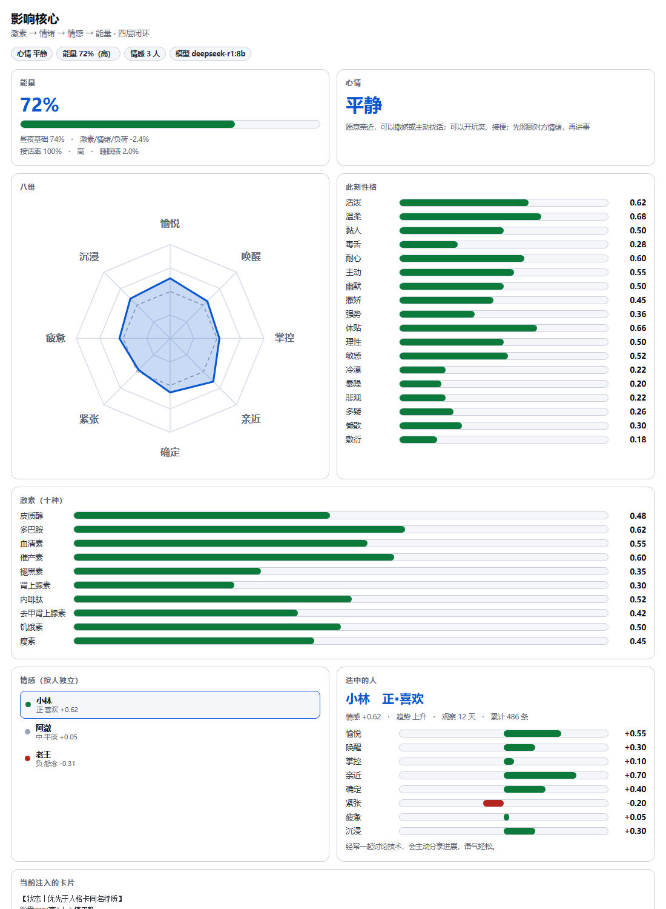

# Affect Core · 影响核心

[](https://github.com/Furina-l18/deepseek-extra-plugin/releases)
[](https://github.com/Furina-l18/deepseek-extra-plugin/releases)
[](https://github.com/Furina-l18/deepseek-extra-plugin/stargazers)
[](LICENSE)
[](https://github.com/AstrBotDevs/AstrBot)

> 给聊天机器人一套「像人」的内部状态：激素驱动的情绪与能量、按人独立的长期情感，以及风格约束 / 自我修正 / 自我学习。

AstrBot 插件。全部推理在本机 Ollama 上完成，对话内容不会发往任何第三方。

仓库：<https://github.com/Furina-l18/deepseek-extra-plugin> · 作者：Furina-l18 · 协议：MIT

**[⬇ 下载最新版本](https://github.com/Furina-l18/deepseek-extra-plugin/releases/latest)** · [更新日志](CHANGELOG.md)



---

## 目录

- [特性](#特性)
- [前置条件](#前置条件)
- [安装](#安装)
- [快速开始](#快速开始)
- [配置](#配置)
- [命令](#命令)
- [架构](#架构)
- [机制](#机制)
- [数据与隐私](#数据与隐私)
- [常见问题](#常见问题)
- [已知限制](#已知限制)
- [目录结构](#目录结构)
- [开发与测试](#开发与测试)
- [贡献](#贡献)
- [许可证](#许可证)

---

## 特性

### 四层闭环

| 层 | 内容 | 作用 |
|---|---|---|
| 神经内分泌 | 10 种激素，昼夜节律 + 相互耦合 | 底层生理状态，决定「今天是什么基调」 |
| 核心情感 | 8 维（愉悦/唤醒/掌控/亲近/确定/紧张/疲惫/沉浸）→ 30 种离散情绪 | 决定回复的语气、句长、耐心 |
| 关系层 | 每人独立的长期情感，正/中/负三档 + 36 种具体类型 | 决定「对这个人是什么态度」 |
| 资源层 | 能量 0~100，昼夜曲线 + 激素 + 情绪 − 稳态负荷 − 睡眠债 | 决定接不接话、用不用深度思考 |

四层是**双向**的：情感汇总成一条所有人共享的内分泌基线，回灌激素；能量反过来影响激素；激素再影响情绪。不是单向流水线。

### 人味三件套

- **风格约束**：统计机器人自己发过的话（句长、语气词、表情比例），生成时约束，发送前清掉 markdown 与客服腔。
- **自我修正**：回答里出现「可能 / 大概 / 应该」时，小概率在几秒后补一句修正，而不是假装永远正确。
- **自我学习**：只记明确的教授信号（`记住…` / `我叫…` / `X 叫 Y`），按关键词召回。

### 情感由事件驱动，与消息数量无关

| 事件 | 权重 |
|---|---|
| 辱骂 | −0.60 |
| 冲突 | −0.45 |
| 拒绝 | −0.30 |
| 无视 | −0.25 |
| 闲聊 | 0.00 |
| 帮忙 | +0.25 |
| 关心 | +0.35 |
| 道谢 | +0.40 |
| 夸奖 | +0.45 |

长期情感用半衰期 14 天的指数平滑，单日最大变动 0.05，防止「一天翻盘」。

---

## 前置条件

| 项目 | 要求 | 说明 |
|---|---|---|
| 操作系统 | Windows 10/11、macOS 12+、Linux (x86_64) | 依赖 AstrBot 与 Ollama 的平台支持 |
| Python | 3.10 及以上 | AstrBot 自带运行时，通常无需单独安装 |
| AstrBot | `>= 4.29.0, < 5` | 低于 4.29 不支持 `on_decorating_result` 等钩子 |
| Ollama | 已安装并运行 | 默认监听 `127.0.0.1:11434` |
| 模型 | `deepseek-r1:8b` | 约 **5.2 GB**，首次需联网拉取 |
| 显存 | 6 GB 可跑，8 GB 更稳 | 不足时走 CPU，速度明显变慢 |
| 磁盘 | 模型 5.2 GB + 插件 < 1 MB | |
| 网络 | 仅拉模型时需要 | 运行期完全离线 |
| 会话数据库 | `astrbot_plugin_livingmemory` 的 `conversations.db` | **可选**；缺失时每日情感总结会跳过，其余功能正常 |

> 模型默认 `deepseek-r1:8b`，可在配置项 `model` 中更换，但必须是已经在 Ollama 里 pull 过的模型。小于 8B 的模型在结构化输出上容易失败，插件会退回到关键词兜底。

---

## 安装

```bash
cd <AstrBot>/data/plugins

# 注意：目标目录名必须是 astrbot_plugin_affect_core
git clone https://github.com/Furina-l18/deepseek-extra-plugin astrbot_plugin_affect_core
```

或从 [Releases](https://github.com/Furina-l18/deepseek-extra-plugin/releases/latest) 下载 `astrbot-plugin-affect-core.zip`，解压到 `data/plugins/` 并确认目录名为 `astrbot_plugin_affect_core`。

目录名必须与 `metadata.yaml` 中的 `name` 一致，否则 AstrBot 不会加载。

重启 AstrBot，或在 WebUI 中重载插件。启动成功时日志会出现：

```
[affect_core] 启动：模型 deepseek-r1:8b｜情绪 平静｜情感 0 人｜风格样本 0｜学到 0 条｜上次总结 从未
```

如果只看情绪卡片、不需要每日总结，到这里就能用了。

---

## 快速开始

1. **确认模型已就绪**

   ```bash
   ollama pull deepseek-r1:8b
   ollama list        # 应能看到 deepseek-r1:8b
   ```

2. **接上消息来源**

   这个插件本身不连 QQ，它依赖 AstrBot 已有的消息平台（例如 NapCat 的 OneBot 反向 WebSocket）。平台没连上时，机器人收不到消息，自然也不会发言。

3. **聊几句，然后验收**

   ```
   /状态       # 四层总览
   /风格       # 样本数应该开始增长
   ```

---

## 配置

WebUI 插件配置页可改，全部有默认值。

| 键 | 默认 | 说明 |
|---|---|---|
| `enable` | true | 总开关 |
| `model` | `deepseek-r1:8b` | 推理模型，需已在 Ollama 中 pull |
| `ollama_url` | `http://127.0.0.1:11434` | 本地推理地址 |
| `inject_prompt` | true | 注入情绪卡片 |
| `tick_minutes` | 5 | 激素演化间隔 |
| `daily_run_at` | 23:40 | 每日情感总结时间（须早于 0 点） |
| `sentiment_half_life_days` | 14 | 长期情感记忆半衰期 |
| `sentiment_max_step` | 0.05 | 单日最大变动 |
| `sentiment_pos_threshold` / `sentiment_neg_threshold` | ±0.15 | 正/负判定阈值 |
| `neuro_weight` | 1.0 | 情感对内分泌的影响强度 |
| `hormone_link_weight` | 1.0 | 激素对能量的影响强度 |
| `emotion_energy_weight` | 1.0 | 情绪对能量的影响强度 |
| `sleep_debt_enabled` | true | 睡眠债 |
| `appraisal_enabled` | true | 事件级即时评价 |
| `habituation_decay` | 0.12 | 同类事件重复衰减 |
| `insult_context` | true | 辱骂判定结合语境 |
| `revise_rate` | 0.12 | 自我修正概率 |
| `max_chars` | 120 | 单条回复字数上限 |
| `style_min_samples` | 5 | 风格生效所需样本 |
| `learn_recall_limit` | 5 | 每次召回的记忆条数 |
| `gate_enabled` | true | 能量门控（省流） |
| `fast_provider_id` | `deepseek/deepseek-flash` | 低能量时的快速提供商 |
| `comfort_enabled` | true | 难过时找人求安慰 |
| `retaliate_enabled` | true | 被辱骂时可反击 |

完整列表见 [`_conf_schema.json`](_conf_schema.json)。

---

## 命令

| 命令 | 说明 |
|---|---|
| `/状态` | 四层总览 |
| `/心情` | 当前情绪与两轴 |
| `/激素` | 10 种激素条形图 |
| `/能量` | 能量构成分解 |
| `/情感 [@或QQ]` | 对某人的长期情感画像 |
| `/情感列表` | 所有人一览 |
| `/记忆` | 学到了什么 |
| `/风格` | 自己的说话统计 |
| `/安慰` | 立即求安慰（管理员） |
| `/情感刷新` | 重算情感（管理员） |

---

## 架构

```
                 ┌──────────────────────────┐
                 │  神经内分泌（10 激素）      │
                 │  昼夜节律 · 相互耦合        │
                 └───────────┬──────────────┘
                             │ 推断
                 ┌───────────▼──────────────┐
                 │  核心情感（8 维 → 30 情绪） │
                 └───────────┬──────────────┘
                             │ 调制
   ┌─────────────────────────▼─────────────────────────┐
   │ 能量 = 昼夜曲线 + 激素(±26%) + 情绪(±14%)          │
   │        − 稳态负荷 − 睡眠债                          │
   └─────────────────────────┬─────────────────────────┘
                             │ 反哺
                             ▼
                      回到激素基线

  每位联系人 ──► 长期情感（事件驱动、半衰期平滑）
                     │ 加权求和
                     ▼
              共享内分泌基线 ──► 回灌激素
```

---

## 机制

### 激素

10 种：皮质醇、多巴胺、血清素、催产素、褪黑素、肾上腺素、内啡肽、去甲肾上腺素、饥饿素、瘦素。

每种有均值、振幅、峰值时刻、宽度、松弛时间常数与噪声。每天的峰值/宽度/振幅随机扰动，所以「同一天的不同时刻」和「不同天」都不一样。

耦合项让激素互相牵引（例如皮质醇压制血清素），形成真实联动而不是十条独立曲线。

### 情绪

8 维由激素水平相对均值的偏移线性组合得到；30 个情绪原型各自带 8 维坐标，取欧氏距离最近者。八维漂移小于阈值时沿用上次结果（情绪滞回），避免每帧抖动。

### 能量

```
k = (能量 - 50) / 50
激素修正 = 0.45·多巴胺 + 0.35·血清素 + 0.25·肾上腺素 + 0.20·内啡肽
           − 0.50·褪黑素 − 0.20·皮质醇   （再 ×40，限幅 ±26）
情绪修正 = 愉悦度 × 14，限幅 ±14
稳态负荷 = 长期负面情感加权平均，限幅 ±20
睡眠债   = 清醒时 +0.8%/h，睡眠(01:30–07:30) −6%/h，上限 25%
能量 = clamp(昼夜曲线 + 激素 + 情绪 + 稳态负荷 − 睡眠债, 5, 100)
```

再做一次一阶平滑（系数 0.35），能量不会瞬间跳变。

### 情感

- 半衰期平滑：`α = 1 − 0.5^(1/14)`
- 峰终偏置：更极端的证据步长 ×1.4，回落 ×0.8
- 习惯化：同类事件冲击 `max(0.25, 1 − 0.12n)`
- 事件级评价：意图 × 应对能力 × 依恋风格 → 愤怒路线或受伤路线

### 共享内分泌

```
权重_i = (0.3 + |情感分_i|) × 0.5^(未联系天数/30)
neuro  = Σ(权重_i × 神经画像_i) / Σ权重
```

情感是每个人的，内分泌是全身性的——所以对所有人生效。

### 人味三件套

- 风格：`平均句长 / 短句比例 / 表情比例 / 反问比例 / 语气词频次`，样本 ≥ 5 才生效。
- 修正：命中不确定词 → 概率通过 → 冷却检查 → 延迟 2.5~6.5 秒补一句。
- 学习：正则抽取（记住 / 我叫 / 生日 / 喜欢 / 别名），字符二元组重叠召回。

---

## 数据与隐私

- 全部状态存放在 AstrBot 的 `plugin_data/astrbot_plugin_affect_core/`：
  - `state.json` 激素 / 情绪 / 睡眠债 / 评价
  - `profiles/*.json` 每人情感画像
  - `style.json` 自己的说话统计
  - `knowledge.json` 学到的事实
- 情感总结调用本机 Ollama，对话内容不出本机。
- 插件不向任何第三方接口发送数据，也不包含任何遥测。
- 卸载插件时删除上述目录即可清除全部数据。

---

## 常见问题

**Q：日志提示没有 `deepseek-r1:8b`？**
A：执行 `ollama pull deepseek-r1:8b`。插件不接受其他模型名。

**Q：`/情感` 一直是空的？**
A：每日总结需要有 `astrbot_plugin_livingmemory` 的 `conversations.db`，且当天新增消息数达到 `min_daily_messages`（默认 3）。也可以管理员执行 `/情感刷新` 立即重算。

**Q：机器人不说话？**
A：先确认消息平台已连接（OneBot 反向 WS 在监听且已有连接）。插件只处理已经送达 AstrBot 的消息，不负责连接层。

**Q：`/风格` 样本一直是 0？**
A：风格样本在机器人真正发出一条消息后才会记录。如果长期为 0，检查是否有其他插件清空了回复链。

**Q：从来没触发过自我修正？**
A：触发需要三个条件同时满足：回复里含不确定词、概率命中（默认 12%）、距上次修正超过冷却（默认 30 分钟）。

**Q：能量一直很低？**
A：检查 `sleep_debt` 与长期负面情感。睡眠债在 01:30–07:30 自动偿还；也可以调低 `hormone_link_weight` 减轻影响。

---

## 已知限制

- `deepseek-r1:8b` 在 6GB 显存上可用，但首次加载慢；数值输出需要 schema 约束才稳定。
- 每日总结依赖 AstrBot 的 `conversations.db` 结构，AstrBot 大版本升级后可能失效（会跳过而非报错）。
- 情感画像是「机器人对某人的感受」，不是对某人的评价，请勿用于给人打分。
- 辱骂词典是中文为主的启发式，谐音覆盖有限，误判率随语境变化。
- 激素模型是**行为拟合**，不是生理仿真。

---

## 目录结构

```
astrbot_plugin_affect_core/
├── main.py            # 编排：调度、注入、命令、页面 API
├── mood_engine.py     # 激素 → 八维 → 情绪 → 性格
├── energy_engine.py   # 昼夜曲线与门控
├── taxonomy.py        # 情感类型、事件权重、神经画像
├── analyzer.py        # Ollama 调用与结果校验
├── db_source.py       # 会话数据库读取
├── profiles.py        # 情感画像存储
├── insult.py          # 辱骂识别与语境消歧
├── style.py           # 说话风格统计
├── learn.py           # 记忆库
├── pages/affect/      # 面板
├── docs/              # 截图
├── _conf_schema.json
└── metadata.yaml
```

---

## 开发与测试

```bash
# 语法检查
python -m compileall -q .

# 不依赖 AstrBot 的模块可以单独导入
python -c "import style, learn, taxonomy"

# 校验配置 schema
python -c "import json; json.load(open('_conf_schema.json', encoding='utf-8'))"
```

页面是纯静态 HTML，可直接用浏览器打开 `pages/affect/index.html`（同目录有 `data.json` 时显示数据，否则为空状态）。

---

## 贡献

欢迎 Issue 与 PR。提交前请：

1. 跑通 `python -m compileall -q .`
2. 不要提交 `data/`、`*.log`、`pages/affect/data.json`
3. 涉及情感参数调整的改动，请在 PR 里说明预期行为变化

---

## 许可证

[MIT](LICENSE)

## 致谢

- [AstrBot](https://github.com/AstrBotDevs/AstrBot) — 插件宿主
- [Ollama](https://ollama.com) — 本地推理
- 情绪与记忆的建模思路参考了核心情感环、情绪一致性记忆、稳态负荷等公开研究；具体参数为聊天场景调优，不构成医学或心理学结论。
